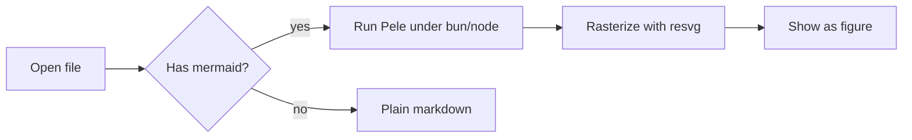
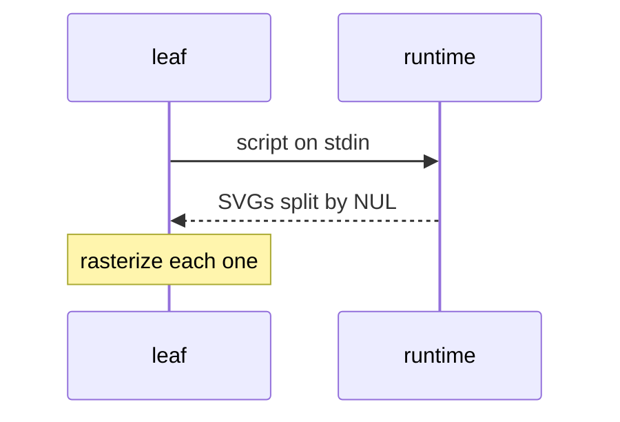
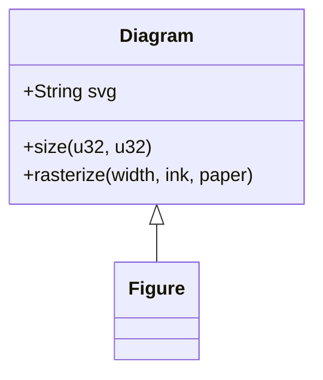
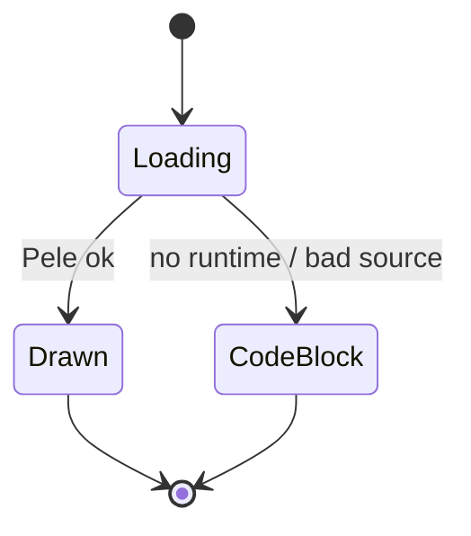
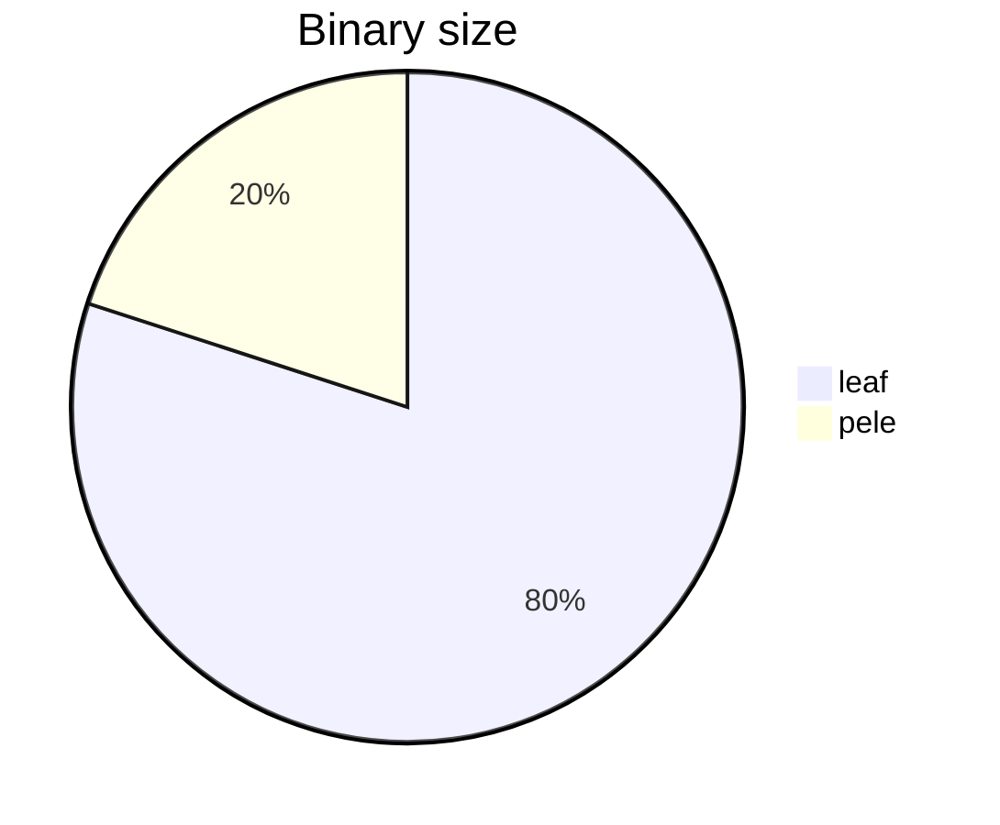
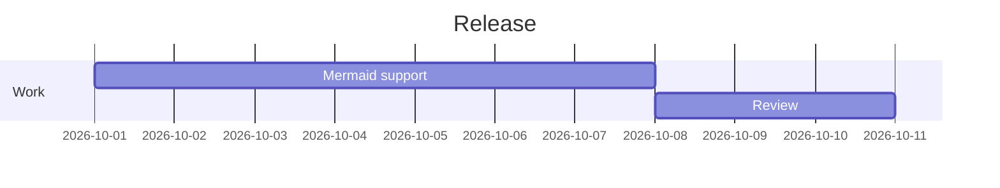
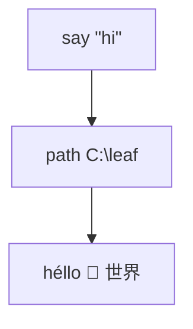
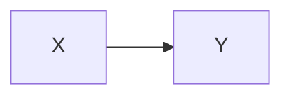

# Mermaid diagrams

Open with `cargo run -- open examples/mermaid.md`. Each section says what you should see.

## Flowchart

Should draw as a diagram.



## Sequence diagram



## Class diagram



## State diagram



## Pie chart



## Gantt



## Quotes, unicode and escapes

Labels with quotes, backslashes and non-ASCII should survive. Known gap: the emoji draws as blank space (resvg doesn't draw color emoji fonts).



## Diagram followed directly by text


This line must still show, as its own paragraph below the diagram.

## Invalid source

Should stay a code block showing its source.

```mermaid
this is not a diagram at all
```

## Other languages are untouched

```rust
fn main() {
    println!("still a code block");
}
```

## Inside a blockquote

Known limitation: the diagram shows after the quote, not inside it.

> Quoted text
>
> ```mermaid
> graph LR
>   Q --> R
> ```
